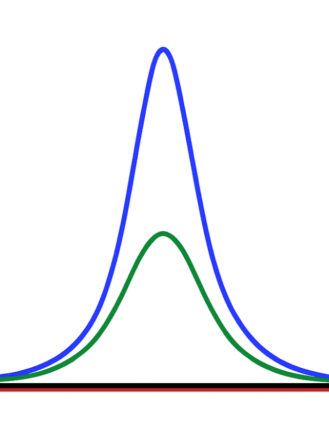

<h1 align="center"> SangerAnalyst — A Free, Web-Based Sanger Sequencing Analysis Tool</h1>

  

---

SangerAnalyst provides a lightning-fast and straightforward way to process Sanger chromatograms within seconds—no installation required and 100% free.

The application performs automated quality trimming, forward–reverse read alignment, consensus generation guided by per-base Phred scores, and anchor-based primer trimming. It also produces a clear conflict report, making mismatches, gaps, and low-confidence positions immediately visible.

This streamlined workflow enables users to obtain an accurate consensus sequence while saving significant time and avoiding the usual manual analysis headaches.

👉 **Support new features on the web:**  
https://bioassembly.github.io/sangeranalyst

---

## ✨ Features

- **Input chromatograms** — forward/reverse traces appear immediately on file selection or **Try demo data**, with zoom, pan, quality shading and secondary-peak markers. Typical-peak scaling keeps neighboring peaks readable; **Fit all peaks** reveals full heights. Select a marker or choose a peak to inspect its bases and original-signal ratio. Traces work without the analysis API. Secondary-peak markers appear after Analyze and refilter locally when trimming or threshold settings change.
- **Final read alignment** — the server's read alignment is visible immediately below each consensus, with mismatch/gap highlighting and preserved coordinates.
- **Quality-weighted consensus** — Mott trimming, automatic orientation detection, statistically validated overlap, PolyPhred-style heterozygote calling (IUPAC codes), and conflict/secondary-peak reports embedded in each output.
- **Smart upload & primer handling** — drag & drop `.ab1` auto-pairing (`_F`/`_R`, `27F`/`1492R`, etc.), 1-click `⇄` F/R swap, plus FASTA (`.fasta`/`.fa`/`.fna`/`.txt`) or pasted primer sequences (IUPAC accepted, min 10 bases).
- **Clean FASTA & Full Report exports** — High-Confidence Consensus, Full Merge, and conditional Primer-Trimmed Consensus each provide **Copy FASTA** / **Download `.fasta`** (strict FASTA for BLAST/SnapGene/Biopython) alongside **Copy Report** / **Download Report (`.txt`)**; IUPAC ambiguity bases are highlighted strictly on sequence lines.
- **Demo dataset** — **Try demo data** button loads the bundled control files instantly.
- **Remembered settings** — Mott cutoff, min Phred, and secondary-peak threshold persist in your browser (localStorage).
- **Mobile-friendly** — responsive layout, FAQ accordion, tooltips, and inline validation (5 MB per `.ab1`, ABIF signature check).

---

## 📂 Demo Dataset

A publicly available control dataset is provided for users to test the tool without uploading their own files.

### **Source**
CRISPR-Cas9 edited cane toad *tyrosinase* gene — control samples (public domain data)  
DOI: https://doi.org/10.1101/2025.05.15.654396

### **Included demo files**
- `fwd_control.ab1`  
- `rev_control.ab1`  
- `primer_fwd.fasta`  
- `primer_rev.fasta`  

These files are available in the **`public/demo/`** directory of this repository (also loadable directly in the app via the **Try demo data** button).

---

## 🚀 Usage Guide

### **1. Open the Webpage**  
Visit **https://bioassembly.github.io/sangeranalyst**

### **2. Upload Input Files**
Prepare the following files:  
- Forward read chromatogram (`.ab1`)  
- Reverse read chromatogram (`.ab1`)  
- Primers (optional; can be uploaded or typed)

### **3. Adjust Processing Settings (Optional)**  
Defaults work well for most datasets (Mott `0.1`, min Phred `20`, secondary peak `33%`).  
- **Mott Trim Cutoff** — Controls how aggressively low-quality regions are removed before alignment.  
- **Minimum Base Phred Quality** — Bases below this threshold are replaced with **`N`**.
- **Secondary peak threshold (%)** — Controls the sensitivity for detecting mixed bases (heterozygotes).

  
### **4. Run `Analyze`**  
The backend processes each request in ~0.4 seconds, uploaded data is deleted immediately after processing.

### **5. Inspect Results**
Review each final FASTA and its read alignment directly in the results. Copy or download the sequence or the complete text report. Input chromatograms are available before analysis; final sequence outputs come from the analysis API. Analysis JSON downloads and successful primer-coordinate messages are omitted; fallback warnings remain visible.

You will receive 2 outputs (3 if primer included):

#### 🔹 High-Confidence Consensus  
Derived from the overlapping region of forward–reverse alignment (statistically validated). Conflicts and gaps are reported: sequencing errors are corrected from the higher-quality strand, and heterozygous positions confirmed by secondary peaks are kept as IUPAC ambiguity codes.

#### 🔹 Full Merge  
A full-span merge of both chromatogram alignments. This is where longer amplicons shine: on a ~1,500 bp template, ~900 bp forward and reverse reads share only ~300 bp of overlap — the Full Merge reconstructs the entire 1,500 bp span, while bases outside the overlap originate from a single read (keep that caveat in mind for conclusions). For short amplicons it is mainly useful for mapping and reference visualization.

#### 🔹 Primer-Trimmed Consensus  
Primer regions removed from the full merge:  
`---Primer_F | -----High Confidence Consensus----- | Primer_R---`  
This provides the longest methodologically reliable sequence, though meaning it's outside High Confidence Consensus region originate from single-read data, which may still have some mismatch or gap compared to the real life biologic DNA sequence.

---

## Development and analysis exports

Run `npm ci`, `npm test`, and `npm run build`. Browser checks use `npm run test:browser` after installing Chromium with `node node_modules/playwright-core/cli.js install chromium`.

Results use a panel tabset: High confidence, Full merge, and Primer trimmed when supplied. Each tab keeps its FASTA, final read alignment and exports together. A shared secondary-peak table below the tabs uses the selected output’s consensus coordinates. Highlighted conflicts open the corresponding chromatogram bases, with a return control. Primer-trimmed output displays the full assembly alignment with an explicit coordinate note. Full reports remain available as text downloads. Editing reads, primers, or settings marks the completed analysis stale and disables exports until rerun. Downloads use the filenames and settings captured for that analysis.

The NCBI BLASTn button copies the chosen FASTA and opens NCBI for pasting. Further interface proposals are recorded in [the improvement plan](docs/UI_IMPROVEMENT_PLAN.md).

Primers accept raw DNA or one FASTA record, with IUPAC ambiguity codes, at least 10 bases, and a 5 MB input limit. Invalid encoding, digits, and multiple records are rejected. Ambiguous dropped read pairs require explicit Forward/Reverse slot assignment.

## 🛠️ Roadmap (To-Do Next)

- 🧭 **Reference mapping** — align consensus to a reference and highlight differences.  
- 📦 **Batch processing** — analyze multiple samples at once.
- 📈 **Viewer enhancements** — consistent orientation and quality preview across analysis routes.

---

## 📚 Acknowledgement

This project uses **BioPython** for AB1 parsing and core sequence utilities. Its modules provide reliable foundational functions required for Sanger data processing.

---

  Made for easy, fast, and accurate Sanger sequencing analysis.

